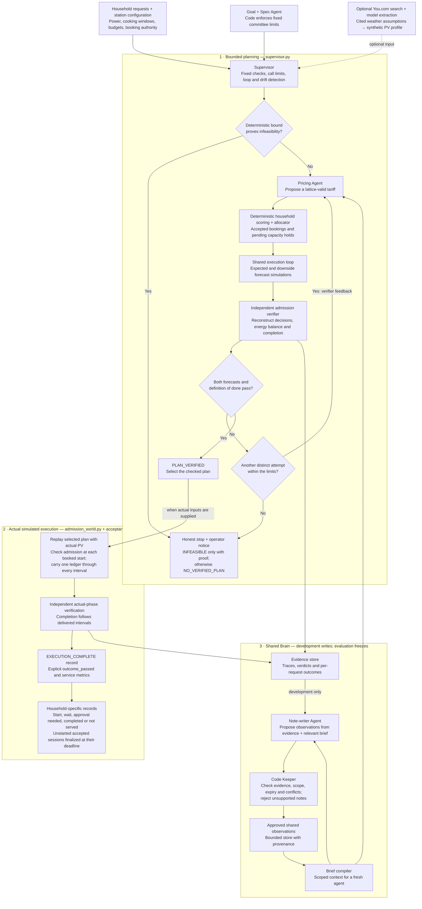

# Green-Stove Agents

A shared memory experiment for household energy coordination at a simulated solar cooking station.

**Integration status (Oct 17):** the combined environment and agent flow on `environment-evidence` passes 308 tests, the acceptance check and the mock end-to-end pipeline. The `abel-admission` world uses independent energy verification and produces household-specific execution records. These checks do not establish live model quality or a memory advantage; see [the integration handoff](docs/environment-integration-ready.md).

## What we are building

Six to ten synthetic household agents have different appliance powers, cooking durations, acceptable windows and budgets. A Pricing Agent proposes community-bounded prices. Deterministic household acceptance, reservations and simulation check whether a plan meets fixed requirements.

A shared brain stores scoped observations of successful and failed attempts. Fresh agents receive relevant observations rather than an ever-growing transcript. A code Keeper reconstructs approved facts from evidence and excludes unsupported or incompatible entries.

Primary hackathon prompt: **Shared Brain**. Fixed verification and honest stopping support Done Means Done. The project does not claim deployed autonomy or Version N+1 strategy evolution.

## How the current system flows

This diagram follows `GREENSTOVE_WORLD=abel-admission`. Household agents use deterministic
rules; Pricing and Note-writer use the model adapter (mock in the validated runs, or
Crusoe-hosted models in live mode). Cooking happens on appliances in individual homes.



Admission reserves enough stored energy for the full cooking session, existing commitments
and remaining essential demand through day end, above the battery floor. It gives no credit
to future solar; observed solar can charge the battery. Pending offers cannot start.

Household notices are simulated, in-process records. During evaluation the brain is frozen
and Note-writer updates are disabled. Facts-only, raw-history and curated-memory agents are
compared with last-tariff reuse, nearest-context reuse and deterministic search through the
same environment. NemoClaw/OpenShell packaging and the separate Version N+1 experiment are
described below; they are outside this core execution diagram.

## The claim we will test

Does curated shared experience reduce planning effort at comparable service, relative to facts only, raw history, last-tariff reuse, nearest-context tariff reuse, and deterministic price search?

The baselines get the same current facts, household behavior, resource checks and action lattice. Evaluation memory is frozen. Count simulator evaluations, latency, cost, completed meals and violations, not just LLM calls. Report a negative result if reuse/search performs better.

## Interactive UI

`.venv/bin/gsa ui` starts a local page at http://127.0.0.1:8765 (this machine only) with four
panels: play a household and ask its household agent, run the Green-Stove agent on any scenario
and memory mode, explore and test the Shared Brain (offer a note to the Keeper), and use the
sponsor tools (Crusoe model catalog and usage, a You.com forecast the agents can plan on, the
NemoClaw guardrail check and always-on runner events). `gsa replay` writes a static HTML replay of
a recorded demo run.

## Run it (agent layer, branch `agents-memory`)

```bash
scripts/setup.sh                                         # install, tests, mock smoke, readiness table
.venv/bin/python -m greenstove demo --pause              # the demo scenes (mock unless live is on)
.venv/bin/python scripts/set_crusoe_key.py --enable-live # key via native dialog, live mode on
.venv/bin/python -m greenstove preflight --mode crusoe   # PASS/WARN/FAIL before going live
.venv/bin/python -m greenstove e2e --mode crusoe         # every step: preflight, Crusoe models/bench, forecast,
                                                         # decide, warm-up, freeze, A/B/C, Version N+1, runner, demo, usage
```

Commands default to a labeled development stand-in (`stub-env`). Set
`GREENSTOVE_WORLD=abel-admission` to use the combined, independently verified environment.
Mock mode remains labeled MOCK and does not establish model quality. See
[docs/end-to-end.md](docs/end-to-end.md), [docs/demo-runbook.md](docs/demo-runbook.md) and
[docs/agent-layer.md](docs/agent-layer.md).

## Two-person build

| Owner | Responsibility |
| --- | --- |
| Abel | Environment, household acceptance, allocation, simulator, verifier, baselines, evaluation and evidence |
| Partner | Crusoe/Nemotron adapter, agent loop, Note-writer, Keeper, briefs, audit and demo |
| Both | Shared contract, integration gates, experiment freeze, cross-review and submission |

Start with [PLAN.md](PLAN.md). It contains the ordered tasks, six-hour reference schedule, gates C0-C6 and cuts. Commands in the contracts are intended interfaces until implemented.

## Event tracks and sponsor tools

Latest full results page (mock model, stand-in world, labeled): [results-mock.md](docs/evidence/results-mock.md),
generated by `gsa e2e` → `gsa report`. Live numbers replace it after the live run.

Requirement-by-requirement check of all three tracks: `gsa tracks` (17 checks on real code
paths, see [docs/tracks.md](docs/tracks.md); latest mock run:
[tracks-scorecard-mock.md](docs/evidence/tracks-scorecard-mock.md), 17/17 PASS, mock model on the stub world).

| Event item | How Green-Stove Agents uses it | Command | Status |
| --- | --- | --- | --- |
| **Shared Brain** (primary track) | Every agent reads a 600-token brief from one shared memory before it works; after it works, a code Keeper admits only notes that match recorded evidence, rejects fabricated numbers and rule changes, keeps conflicts scoped, expires stale entries; frozen for evaluation; fresh agents compared with no memory and raw history on held-out days | `gsa warmup`, `gsa brain show\|audit`, `gsa freeze`, `gsa eval-agents` | Built, tested in mock; live measurement pending |
| **Done Means Done** | A Spec Agent turns the one-line goal into a definition of done (code may tighten, never loosen); an independent simulator + verifier checks expected and downside forecasts; the Supervisor catches looping (repeated tariff) and drifting (attempts getting worse), records each decision (continue, re-plan, stop, ping a human), proves infeasibility before spending calls, and writes an operator decision record; the always-on runner lets you walk away | `gsa spec`, `gsa run`, `gsa decide`, `gsa runner` | Built, tested |
| **Version N+1** | Reviewer agent rewrites the Pricing Agent's playbook from development runs; a change is kept only if it scores better on development days; before/after on unseen days | `gsa evolve`, `gsa playbook before-after` ([version-n-plus-1.md](docs/version-n-plus-1.md)) | Built, mock-tested (separate, labeled experiment); live run pending |
| **Crusoe Managed Inference** | All model calls; live catalog for exact Nemotron ids, supported parameters and pricing; per-role routing; structured output; thinking control; prompt-cache and cost accounting; rate-limit handling | `gsa models`, `gsa bench`, `gsa usage` ([crusoe.md](docs/crusoe.md)) | Built; tested against a simulated endpoint; live run pending key |
| **NVIDIA Nemotron** | Pricing Agent, Note-writer, forecast extractor (and Version N+1 reviewer) | banner of every command | Pending first live call |
| **You.com** | Cited weather forecast for the site and date; values kept only if the quote is in the retrieved page; converted to a solar profile | `gsa forecast`, `gsa decide --forecast` | Built, mock-tested; live pending key |
| **NVIDIA NemoClaw / OpenShell** | Always-on, event-driven runner packaged for a NemoClaw sandbox on a teammate's WSL2/NVIDIA laptop: only Crusoe/You.com egress, frozen memory and config read-only | `gsa event …`, `gsa runner --once\|--watch\|status`, `deploy/nemoclaw/` ([always-on.md](docs/always-on.md)) | Runner built and tested; NemoClaw kit written from the docs, not yet run in a real sandbox (teammate's WSL2 laptop) |

## Existing work and scope

Green-Stove hardware and pilot concepts predate the agent build and must be identified as prior work. New hackathon contributions must be listed with commits when implemented. This prototype controls no live hardware and establishes no clinical, environmental or deployment outcomes.

The root Word document, Green-Stove Agents — Problem & Solution.docx, remains historical background. Its unattended-operation, local-inference, SMS, planting and federation claims are not the current MVP. Do not copy those claims into the submission. Relevant impact statistics and pilot performance require sources or records; see [assumptions.md](docs/assumptions.md).

## Documents

| Document | Purpose |
| --- | --- |
| [PLAN.md](PLAN.md) | Authoritative scope, ownership, ordered tasks and joint gates |
| [contracts.md](docs/contracts.md) | Units, typed interfaces, authority and fixtures |
| [checkpoints.md](docs/checkpoints.md) | Shared acceptance checklist, evidence and sign-offs |
| [architecture.md](docs/architecture.md) | Agent/code boundaries and memory flow |
| [simulator-and-evaluation.md](docs/simulator-and-evaluation.md) | Credible baselines, frozen protocol and claim rules |
| [assumptions.md](docs/assumptions.md) | Synthetic parameters and unvalidated claims |
| [submission.md](docs/submission.md) | Demo and submission wording |
| [llm-learnings-and-partner-tools.md](docs/llm-learnings-and-partner-tools.md) | Historical reasoning and proposed integrations |
| [person-b-plan.md](docs/person-b-plan.md) | Person B (Partner) plan: workstreams, diagram, timeline, demo lines, definition of done |
| [agent-layer.md](docs/agent-layer.md) | How the agents plug into Abel's world; integration status |
| [end-to-end.md](docs/end-to-end.md) | The whole pipeline mapped onto checkpoints with clock times |
| [demo-runbook.md](docs/demo-runbook.md) | Stage commands, timing, speakers, fallbacks, video shot list |
| [decisions.md](docs/decisions.md) | Partner decisions against the team diagram; open questions |
| [crusoe.md](docs/crusoe.md) | Crusoe features used and how they are measured |

## Built during the hackathon

All code below was written on October 17, 2026 after the 10:45 AM PT start (the earlier
commits are plans only). Live, recorded-live and mock output are labeled everywhere.

- Agent layer (partner): Crusoe client with budgets and usage log; Pricing Agent; Note-writer;
  Supervisor; Shared Brain (store, Keeper, briefs); held-out A/B/C runner; operator decision
  record; terminal demo with recording/replay; setup, preflight and end-to-end commands;
  You.com forecast and solar profile; Crusoe catalog/benchmark/usage tools.
- World (Abel): C0 typed contract (`greenstove/models.py`), power-only simulator and verifier,
  fixtures and schemas; merged into the agent layer, which uses his types.
- Development stand-in world (`greenstove/stub_env.py`), clearly labeled, used until Abel's
  allocator and battery model land; it is not evidence.
- Results: none yet beyond mock runs; the results table comes from Abel's evaluation and the
  live runs.

