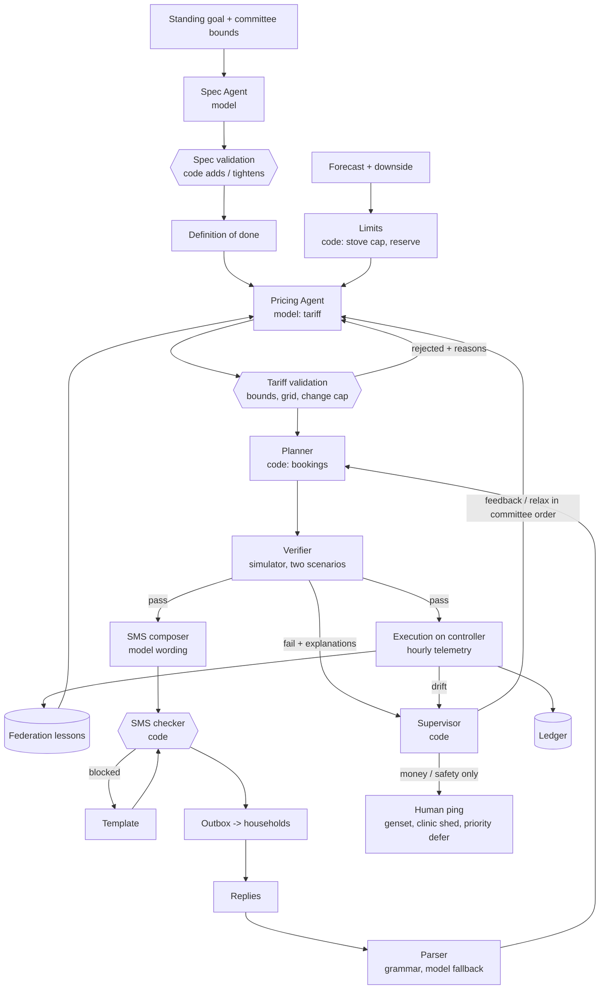
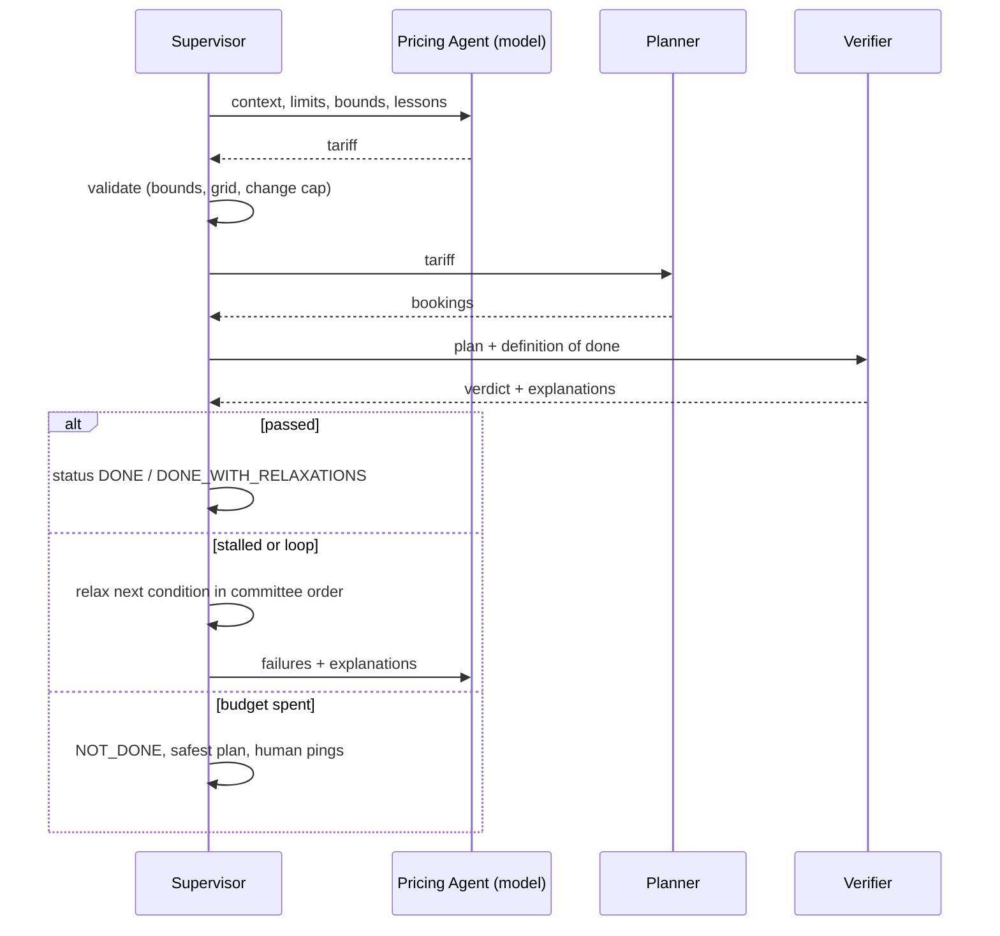

# Architecture

## The daily loop

## Who decides what

| Component | Runs on | Model? | Decides | Cannot |
| --- | --- | --- | --- | --- |
| Spec Agent | HQ (Crusoe) | Nemotron | Draft conditions and rationale | Drop or weaken a hard, human or committee condition |
| Pricing Agent | HQ (Crusoe) or controller | Nemotron | Tier windows and prices | Leave committee bounds, set safety limits, set lifeline |
| Limits | Controller | code | Stove cap per step, cooking reserve | — |
| Planner | Controller | code | Bookings, offers, deferrals | Defer a priority household without a ping |
| Verifier | Controller | code | Pass or fail per condition | — |
| Supervisor | Controller | code | Status, relaxations, replans, pings | Report `DONE` without a passing verdict |
| SMS composer | HQ or controller | Nemotron | Wording in the local language | Send a time or number outside the plan's facts |
| SMS checker | Controller | code | Send, or fall back to template | — |
| Reply parser | Controller | grammar, model fallback | Intent of a reply | Produce authority actions (`VERIFY`, `YES`, `NO`) from free text |
| Ledger | Controller, synced | code | Debits and credits | — |
| Federation | Controller + HQ | code | Which lessons are stored and retrieved | Store model-written lessons |

## Where it runs and what happens offline

- **Connected:** model calls go to Crusoe Managed Inference; lessons and ledger sync to HQ.
- **Station controller:** the Supervisor, Verifier, Planner, checker, parser and ledger are
  plain Python and run on the controller. The same open Nemotron weights can be served
  locally through an OpenAI-compatible server (`GREENSTOVE_LLM=local`), if the controller
  hardware allows it (open question in `assumptions.md`).
- **Offline, no local model:** the Supervisor uses the last verified tariff for the same
  weather class, or the committee's default tariff, still verified before use. SMS use
  templates. Intra-day replans need no model at all.

## Trust boundaries

1. Every model output is a proposal checked against a pydantic schema and the committee's
   bounds.
2. Grading is done by a simulator the model cannot edit or call with its own numbers.
3. Status, ledger entries and lessons are written only by code.
4. Authority actions (approvals, planting verification) come only from registered phone
   numbers through the exact grammar.
5. Human approval is required only for money and safety, and an unanswered request counts
   as denied.

## The planning loop in sequence

