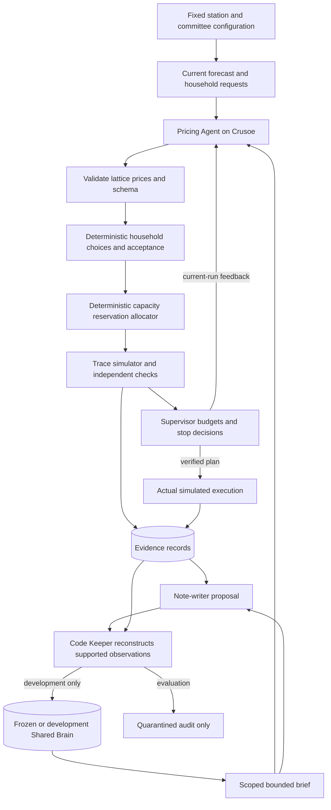

# Architecture

Scope authority: [PLAN.md](../PLAN.md). Data contracts: [contracts.md](contracts.md). Scoring authority: [simulator-and-evaluation.md](simulator-and-evaluation.md). All components below are planned until implemented.

## Coordination loop

## Roles and authority

| Component | Model | Decides | Cannot do |
| --- | --- | --- | --- |
| Pricing Agent | Available Crusoe model, preferably Nemotron | Propose three lattice prices using facts, brief and feedback | Change windows, bounds, requirements, private household preferences or evidence |
| Household agents | Deterministic software | Rank offers and accept within configured authority | Exceed budget/window or reserve unavailable capacity |
| Allocator | Code | Atomic reservations and reason-coded unserved requests | Bypass household authority or fixed resource checks |
| Simulator/verifier | Code | Compute physical outcomes and fixed pass/fail | Trust agent totals or label forecasts real-world guarantees |
| Supervisor | Code | Retry, stop, select verified plan, expose errors | Relax constraints or call three failed attempts infeasible |
| Note-writer | Model | Propose scoped observations and identify duplicates/conflicts | Directly approve memory or establish unrestricted causal rules |
| Keeper | Code | Reconstruct facts from evidence, enforce scope/expiry/caps | Treat a matching number as proof of arbitrary prose |
| Brief compiler | Code | Select supported observations within budget | Serve expired, superseded or configuration-incompatible entries |

## Stores

1. Household configuration: private synthetic preferences and booking authority; source of truth, not learned memory.
2. Coordination state: candidate requests/offers/reservations. Rejected candidates do not commit changes. Accepted quotes are locked.
3. Evidence: immutable per-run proposals, traces, verdicts and call records.
4. Shared Brain: capped structured observations backed by evidence. Include both successes and failures, with phase, configuration and expiry.
5. Audit: rejected notes and evaluation-time proposals. Never feed held-out results back into a frozen memory comparison.

Development writes the brain. Evaluation creates fresh agents with frozen snapshots and consistent current-run feedback. Both Pricing and Note-writer read appropriate briefs; their outputs pass independent code checks. The knowledge handoff is visible through snapshot and entry IDs.

## Optional runtime boundary

If OpenShell integration is completed, place agent tooling under a policy preventing direct writes to approved memory, fixed configuration and evaluator assets. Proposals cross a validated application interface. This complements schema, authorization and Keeper checks; it does not replace them. Verify Crusoe routing and the actual tested policy before claiming the integration.

## Non-LLM comparators

Last-tariff reuse, nearest-context reuse and finite tariff search call the same household, allocator and verifier functions. They receive the same current facts and forecast scenarios. Search uses the same finite action lattice and has budget-3/full results. Only the actual-day evaluator sees actual future weather.

## Status and deployment limits

PLAN_VERIFIED means the modeled forecasts passed. EXECUTION_COMPLETE includes an explicit actual simulated outcome. NO_VERIFIED_PLAN means bounded search failed. INFEASIBLE requires a deterministic bound with recorded assumptions.

The hackathon build does not operate live equipment, make payments, send real SMS, federate villages, or run an unverified model on a station controller. These remain future deployment questions.
