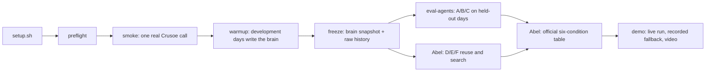

# End to end

How the whole experiment runs, from a clean checkout to the submitted demo, mapped onto
the checkpoints in [PLAN.md](../PLAN.md) and [checkpoints.md](checkpoints.md). Times
are Pacific on October 17 (submission due 5:00 PM; we aim for 4:50).

## The pipeline



One command runs the partner side of it in an isolated folder (`data/e2e-<time>/`):

```bash
.venv/bin/python -m greenstove e2e                 # mock model, labeled MOCK
.venv/bin/python -m greenstove e2e --mode crusoe   # live Nemotron on Crusoe
```

It runs preflight → smoke → models (live) → bench → forecast → decide on the forecast → warmup →
freeze → eval-agents (A/B/C) → evolve → playbook before-after (Version N+1) → runner event →
runner → demo → usage, and writes `e2e-summary.md`. Required steps (smoke, warmup, freeze,
eval-agents, demo) stop the run when they fail; optional ones warn and continue (for example a
forecast without a You.com key).

## Setup (once per machine, about 3 minutes)

```bash
git clone git@github.com:amahaeitbit/green-stove-agents.git && cd green-stove-agents
git switch agents-memory            # until it is merged into main
scripts/setup.sh                    # venv, install, .env, tests, mock smoke, preflight
```

Going live:

1. Crusoe console → sign up at https://console.crusoecloud.com/request-foundry, claim the
   credits (https://forms.gle/JdEvMGSb4TURH1Tq8), **Get API Key** (expires October 18).
2. `.venv/bin/python scripts/set_crusoe_key.py --enable-live`: a native dialog writes the
   key into the ignored `.env` and turns on live mode. Nothing is printed.
3. `.venv/bin/python -m greenstove preflight --mode crusoe`: key, spend flag, model id in
   the catalog, world, brain, tests and git, each PASS/WARN/FAIL. Fix every FAIL.
4. If the model id is not in the catalog, copy the exact Nemotron id preflight lists into
   `GREENSTOVE_MODEL` in `.env`.

## Checkpoints with commands (status at 15:30 PT)

| Checkpoint | Status | Command | Done when |
| --- | --- | --- | --- |
| C0 contract | done: agents import Abel's `models.py` | — | shared types, one protocol |
| C1 first path | mock done; live waiting for the Crusoe key | `smoke --mode live`, `models`, `bench --mode live` | one real Crusoe response recorded; Nemotron chosen by measurement |
| C2 live planning | mock done on all three worlds | `GREENSTOVE_WORLD=abel-admission gsa plan --scenario dev-clear-full --mode live` | real proposals through Abel's allocator and admission ledger |
| C3 shared memory | mock done | `warmup`, `brain stats`, `brain explain`, `demo --scene memory/handoff` | supported notes admitted, fabricated rejected, fresh agent reads a brief |
| C4 freeze | tooling done | `freeze` + Abel's manifest | hashes for brain, history, spec, prompts, model |
| C5 evidence | tooling done; live pending | `eval-agents`, `compare` (A–F), `report` | six-condition table on held-out days |
| C6 submission | open | `demo --mode live --pause`, video, form | submitted by 4:50 |

Abel's integration review (`docs/integration-checkpoint-review.md`) and the partner's answers:
`docs/integration-response.md`.

Demo order, speakers, fallbacks and the video shot list are in
[demo-runbook.md](demo-runbook.md).

## Worlds

| `GREENSTOVE_WORLD` | Households / allocation | Simulation and verdict | Coverage |
| --- | --- | --- | --- |
| `stub` (default) | stand-in | stand-in battery model | complete (stand-in, not evidence) |
| `abel` | Abel's | Abel's C0 simulator and verifier (expected phase, power only) | incomplete: never PLAN_VERIFIED |
| `abel-admission` | Abel's | Abel's admission ledger for every phase; energy verdict by partner glue | complete, pending Abel's sign-off |

## Live cost and limits

Rough upper bound per live end-to-end run: smoke 1 call, warmup about 15 calls, held-out
A/B/C at most 8 days × 3 conditions × 3 attempts = 72 calls (plus repairs), demo about 10.
About 100 calls of roughly 1–2.5 thousand tokens each: small against the $50 credits.
Per-run budgets in `.env` (`GREENSTOVE_MAX_CALLS_PER_RUN`, `GREENSTOVE_MAX_TOKENS_PER_RUN`)
stop a runaway loop with an `ERROR` status, never a fake pass. Without a payment method
Crusoe allows 30 requests per minute per model; the client backs off on 429 and 503.

## Optional: real forecast for the station

`gsa forecast --mode live --place "<site>" --lat <lat> --lon <lon> --date <YYYY-MM-DD>` uses
You.com search and Nemotron extraction to produce a verified forecast record and PV profile,
and `gsa decide --forecast <file>` plans that day with it. Needs `YDC_API_KEY`
(`scripts/set_crusoe_key.py --var YDC_API_KEY`). Held-out evaluation keeps using frozen
scenarios; forecasts are never fetched live during evaluation.

Crusoe features used and how they are measured: [crusoe.md](crusoe.md). After any live run,
`gsa usage` reports calls, tokens, cache hits, latency and cost by role and model.

## What each run leaves behind

| Folder | Contents |
| --- | --- |
| `smoke/` | the recorded real call: proposal, tokens, latency, request id |
| `evidence/` | every verdict as an immutable record, plus one `RunRecord` per agent day |
| `brain/` | approved observations and the Keeper's audit log (admissions and rejections) |
| `freeze/` | frozen brain snapshot, raw development history, `freeze.json` with hashes and commit |
| `eval/` | `agent-runs.jsonl` (A/B/C raw records with stale-entry counts), `agent-summary.md`, `manifest-partner.json` |
| `demo/` | recorded demo transcripts and the fresh demo memory workspace |

Copy what you submit into `docs/evidence/` (no keys are ever written, but check anyway).

## If something is late

| Situation | Decision (with Abel, per PLAN.md section 10) |
| --- | --- |
| No Crusoe key by 1:30 | Keep building in mock; every output says MOCK; no model-quality claims |
| Abel's world not merged by 2:00 | Run end to end on the stub world for the demo, labeled as a stand-in; results are not evidence; narrow the claim |
| Live calls failing during C5 | Use recorded live runs, labeled; never relabel mock output as live |
| Memory shows no benefit | Report it as measured; do not retune held-out days |
