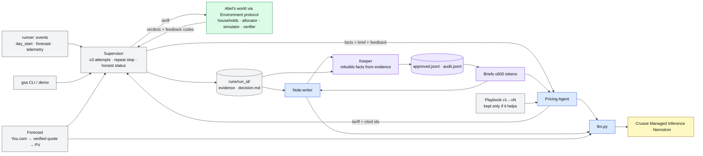

# Person B (Partner) plan: agents and memory

**Role:** turn one fixed set of community rules into agents that plan a mini-grid day
unattended, prove each plan before acting, and share what they learn through an
evidence-checked memory, all on Crusoe-hosted Nemotron.

**Status at 14:10 PT, Oct 17** (branch `agents-memory`, commit `9e29876`, 154 tests passing):
everything below is built and tested in mock mode, on a labeled stand-in world and on Abel's
merged C0 world. No live Nemotron call has run yet; the remaining work is live evidence.

## At a glance

| Workstream | What it delivers | Status | Proof |
| --- | --- | --- | --- |
| B1 Model path | Crusoe client: catalog-driven Nemotron ids, budgets, structured output, caching, cost | Built · live pending key | `gsa preflight --mode live`, `gsa smoke --mode live` |
| B2 Bounded planning | Spec Agent's definition of done; Pricing Agent + Supervisor: 3 attempts, loop and drift detection, decision trail, no relaxation | Built | `gsa spec`, `gsa run --condition A` |
| B3 Shared Brain | Note-writer → Keeper → approved memory → 600-token briefs; stats and provenance | Built | `gsa brain stats`, `gsa brain explain <id>`, `gsa brain audit` |
| B4 Handoff and evaluation | Fresh agent per day; frozen memory; A/B/C on held-out days; demo | Built · live pending | `gsa eval-agents`, `gsa demo` |
| B5 Extensions | You.com forecast, Version N+1, always-on runner + NemoClaw kit, decision record | Built · outside the headline claim | `gsa forecast`, `gsa evolve`, `gsa runner` |
| End to end | Every step in one command, one folder, one summary | Built (14/14 in mock) | `gsa e2e [--mode live]` |

## How the pieces fit

Blue: model calls. Purple: Shared Brain (code only). Green: Abel's code, called, never
edited. Grey: Person B's code. Yellow: Crusoe.

## B1. Model path: Crusoe and Nemotron

**Goal.** One adapter for every model call, with a pinned Nemotron model chosen by measurement.

**Delivered.** `greenstove/llm.py`, `greenstove/crusoe.py`:
- live catalog (`/v1/models`) for exact ids, supported parameters and pricing; nothing hard-coded
- per-role models (pricing, note writer, forecast extractor, playbook reviewer), identical across A/B/C
- structured output (`json_schema` or `json_object` from the catalog) with a remembered fallback
- thinking off by default per role; prompt-cache layout; cached and reasoning tokens recorded
- call and token budgets; every retry counts; 429/503 backoff; `usage.jsonl` without keys
- live calls only with `GREENSTOVE_LIVE_SPEND_OK=1`; a key alone never spends

**Gate (C1).** One real structured response recorded; model id confirmed in the catalog;
`gsa bench --mode live` table saved; winner pinned in `.env`.

**Remaining.** Key in (secure dialog), `smoke`, `models`, `bench`, pin.

## B2. Bounded planning: Done Means Done

**Goal.** Turn a one-line goal into checks the agents run without a human; a fresh Pricing
Agent proposes three lattice prices; code decides everything else.

**Delivered.** `spec_agent.py`, `pricing_agent.py`, `supervisor.py`, `decision.py`:
- Spec Agent writes the definition of done from the one-line goal using only metrics the verifier
  computes; code drops unknown metrics, fixes directions, adds missing committee checks
  (`code_added`) and tightens looser ones (`code_tightened`), so "done" can only get stricter;
  cached per goal, committee and model and frozen for A/B/C (`gsa spec`)
- the Supervisor scores every attempt; an attempt worse than the best so far sends a drift
  warning back to the agent, two worse attempts in a row stop the day ("drifting"); a repeated
  tariff stops it ("looping")
- every run records its decisions: continue (dispatch a verified plan), re-plan (new candidate
  from verifier feedback), stop (looping, drifting, budget, infeasible, model error) and, rarely,
  ping_human (infeasible day or no verified plan on a feasible day)
- the agent sees forecasts only, never actual weather; prices must be in the lattice and tier order
- at most 3 attempts; feedback is the verifier's codes, intervals and values
- stops honestly: `PLAN_VERIFIED`, `NO_VERIFIED_PLAN` (budget or repeated proposal),
  `INFEASIBLE` (deterministic energy bound, before any model call), `ERROR` (model or network)
- a pass from a world with incomplete coverage, or with unmodeled phases, is never `PLAN_VERIFIED`
- `decision.md` per day: tariff and why, memory relied on, both checks recomputed, bookings,
  households that must confirm, rejected alternatives, cost, and what the model could not decide

**Gate (C2).** On Abel's world, a live proposal flows through his allocator and verifier,
and failed checks lead to a new candidate or a reason-coded stop.

**Remaining.** Live runs; switch allocation to Abel's allocator when it lands (one line in
`world_adapter.py`).

## B3. Shared Brain

**Goal.** Shared knowledge that stays current, lean and conflict-free, and measurably helps.

**Delivered.** `note_writer.py`, `brain/keeper.py`, `brain/store.py`, `brain/briefs.py`:
- Note-writer reads a relevant brief, proposes up to 3 observations with a structured claim
- Keeper checks in order and rejects with the first failing code: evidence_unknown →
  evidence_expired → result_mismatch → scope → constraint_edit; duplicates confirm, conflicts
  stay as separate scoped entries (recency is not proof); a forecast pass needs both forecasts
- store: at most 20 entries, successes and failures, expiry on an explicit simulated clock,
  audit log that is never served, frozen snapshots with a verified hash
- briefs: deterministic situation match, 600-token budget, ids and versions logged as supplied;
  each entry shows its outcome (served share, lowest battery, largest shift) and confirmations,
  with a one-line usage hint for the agent
- `gsa brain stats`: current / expired / superseded entries, pass/fail split, conflict groups,
  confirmations, rejections by Keeper code, entries supplied per brief, citation rate, most-cited entries
- `gsa brain explain <id>`: evidence the Keeper rebuilt the entry from, source runs and their
  decision records, Keeper decisions, and every later fresh agent that read it (cited or not, outcome)

**Gate (C3).** A supported note is admitted, a fabricated one rejected, a stale or
incompatible one excluded, and a fresh agent reads the recorded brief.

**Remaining.** Live warm-up; review `brain audit` for any surprising rejections.

## B4. Handoff, evaluation and visible behavior

**Goal.** Show the handoff live, and measure it fairly.

**Delivered.** `agent_eval.py`, `demo.py`:
- `freeze` locks the brain and the raw history from the same development evidence
- `eval-agents` runs A (no memory), B (raw history), C (curated brain) on 8 held-out days
  with rotated order, notes disabled, stale entries counted (must be 0), cost and cache columns,
  and a partner manifest fragment for Abel's evaluation manifest
- demo scenes: world → proposal → memory → handoff → infeasible, on a fresh memory workspace
  so the observation admitted in scene 3 is the one the fresh agent reads in scene 4;
  every run recorded and replayable, labeled RECORDED

**Gate (C4/C5).** Frozen snapshot hashes in the manifest; A/B/C raw records and summary for
all held-out days, failures included; Abel adds D/E/F and owns the official table.

**Remaining.** Live warm-up, freeze, `eval-agents --mode live`, hand records to Abel.

## B5. Extensions (outside the headline A/B/C claim)

| Extension | What it adds | Command | Honest status |
| --- | --- | --- | --- |
| You.com forecast | Cited forecast for the site and date; a value is kept only if its quote is in the retrieved page; converted to a solar profile with a cloudier downside | `gsa forecast`, `gsa decide --forecast` | Mock-tested; live needs a You.com key; default site is a placeholder |
| Version N+1 | Reviewer agent rewrites the playbook; kept only if development scores improve; held-out before/after | `gsa evolve`, `gsa playbook before-after` | Mock-tested; mock obeys directives by design, so live is needed |
| Always-on runner | Events wake the agents; re-plan only on a material forecast change; telemetry below plan raises a human alert with zero calls | `gsa event …`, `gsa runner --once\|--watch\|status` | Built and tested |
| NemoClaw / OpenShell kit | Sandbox on the teammate's WSL2 + NVIDIA laptop: only Crusoe and You.com egress, frozen memory and config read-only, guardrail check | `deploy/nemoclaw/` | Written from the docs; not yet run in a real sandbox |

## Interfaces with Abel

| Direction | Contract |
| --- | --- |
| B calls A | `household_requests`, `allocate(…, proposal_id)`, `simulate(plan, context, phase, actual)`, `verify(trace, requirements, context, plan)`, `lower_bound` (via `world_adapter.py`) |
| A calls B | `run_agent_day(context, memory_mode, requirements, …, phase="evaluation", brain=frozen, history=frozen)` → `RunRecord` |
| Shared | Abel's `greenstove/models.py` types (B imports them); Verdict `coverage` and deterministic ids respected |
| Open questions | citations outside the brief (drop vs reject); metric names; `INVALID_TARIFF` in `Plan`; when household acceptance and battery modeling land ([decisions.md](decisions.md)) |

## Remaining timeline (today, PT)

| Time | Person B | Checkpoint |
| --- | --- | --- |
| 14:15–14:30 | Keys via secure dialog; `preflight --mode live`; `smoke`; `models`; `bench --n 3`; pin the model | C1 live |
| 14:30–15:00 | `run` and `decide` live on the stand-in and on `GREENSTOVE_WORLD=abel`; read decision records; fix prompt issues only on development days | C2 live |
| 15:00–15:30 | `warmup --mode live`; `brain audit`; `freeze`; send `manifest-partner.json` to Abel | C3, C4 |
| 15:30–16:00 | `eval-agents --mode live` (8 days); `evolve` + `before-after` live if budget allows; `usage` | C5 · feature freeze 16:00 |
| 16:00–16:25 | Record live `demo --pause`, keep the transcript as fallback; screen-record the video | C6 |
| 16:25–16:50 | Review numbers and labels with Abel; README "Built during the hackathon"; submit | Submit by 16:50 |

In parallel (teammate, 14:30–15:30): NemoClaw kit on the WSL2 laptop, guardrail check.

## Demo role (Person B speaks 0:25–1:55 and shares 2:45–3:00)

| Time | Scene | Say |
| --- | --- | --- |
| 0:25–0:55 | `proposal` | "A fresh Pricing Agent on Crusoe proposes prices; code books slots and checks both forecasts; it fails with named reasons, then passes." |
| 0:55–1:25 | `memory` | "The Note-writer proposes; the Keeper rebuilds every fact from evidence and admits it. This fabricated note is rejected for numbers that are not in the evidence." |
| 1:25–1:55 | `handoff` | "A new agent on a different day reads those entries, cites one, and passes first time. One example; the held-out table is the evidence." |
| 2:45–3:00 | tools | "Crusoe and Nemotron ran every call: here is the usage and cost. Built today: the agents, the memory and the tooling." |

Full stage script and fallbacks: [demo-runbook.md](demo-runbook.md).

## Definition of done for Person B

- [ ] One live Crusoe call recorded; Nemotron id confirmed; model chosen by `bench` and pinned
- [ ] Live warm-up admitted supported notes; `brain audit` shows at least one rejection with its code
- [ ] Frozen snapshot and history hashes in `manifest-partner.json`
- [ ] Live A/B/C records for every held-out day, stale entries served = 0, failures included
- [ ] `usage` report with tokens, cache hit rate and cost; matches the Crusoe console
- [ ] Live demo transcript saved; fallback replay tested
- [ ] README statuses match what actually ran; no keys in git or logs

## Risks and fallbacks

| Risk | Fallback |
| --- | --- |
| No key by 15:00 | Mock end to end, labeled MOCK everywhere; no model-quality or memory-benefit claims |
| Nemotron returns invalid JSON | Structured output on, one repair, failures counted; `bench` picks the most reliable model |
| Rate limits mid-evaluation | Backoff; reduce held-out days equally across A/B/C and disclose the sample size |
| Abel's allocator or battery model not ready | Live runs on the stand-in for the demo, labeled; his world shown for what it checks |
| Memory shows no benefit | Report it; the Keeper and the honest stops are still the contribution |
| Network fails on stage | `demo --replay latest`, labeled RECORDED |

## What Person B does not claim

The stand-in world and mock runs are not evidence. A forecast-verified plan is not a
guarantee for the real day. Cited memory ids are not causal proof; the frozen A/B/C comparison
is. Version N+1, the forecast and the NemoClaw kit are extensions outside the headline claim.
No real SMS, payments, hardware control or deployed autonomy.
